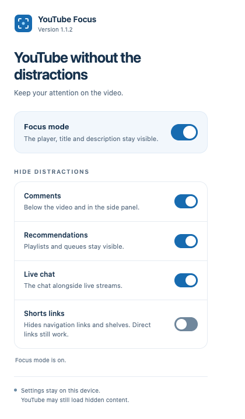

# YouTube Focus

Choose which parts of YouTube to hide while keeping the video controls, title and description accessible.

[Download the latest release](https://github.com/fbn90/youtube-focus/releases/latest)

## Features

- Hide comments, recommendations, live chat and Shorts links independently.
- Keep playlists and queues visible.
- Toggle Focus mode from the extension popup.

## Install

1. Download the extension ZIP from Releases and extract it to a permanent folder.
2. Open `chrome://extensions` and enable **Developer mode**.
3. Choose **Load unpacked** and select the extracted folder containing `manifest.json`. Pin the extension if you want its popup in the toolbar.

For an update, keep the same local extension directory so Chrome retains the extension ID and its local settings.

## Screenshot

## Privacy

Display preferences stay on your device. YouTube may still download content that the extension hides.

## Development

Run the JavaScript checks with `npm test`.

## License

[MIT](LICENSE).
